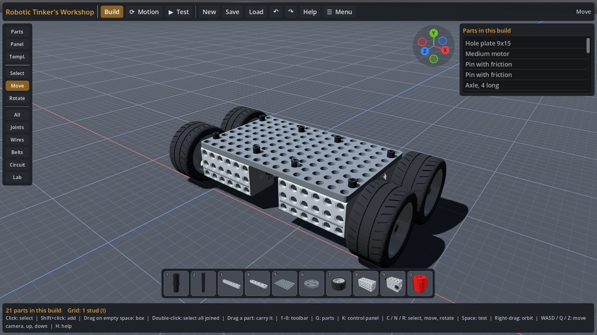
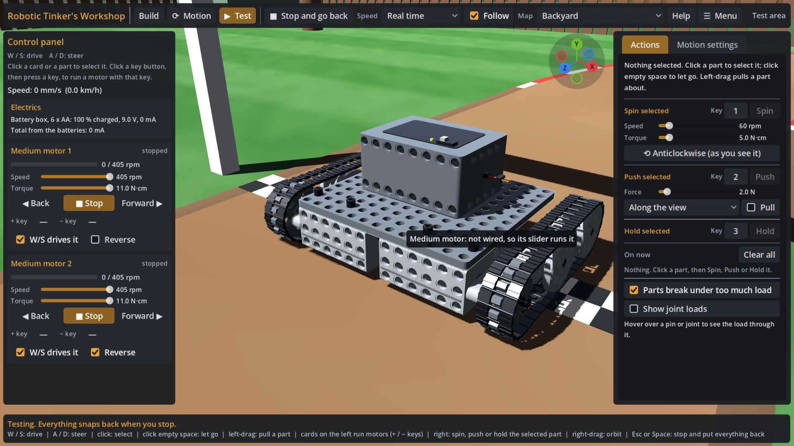
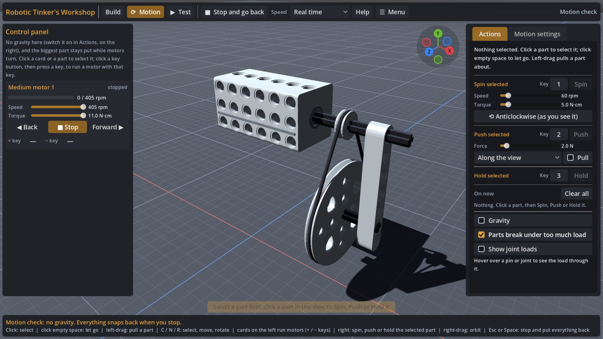
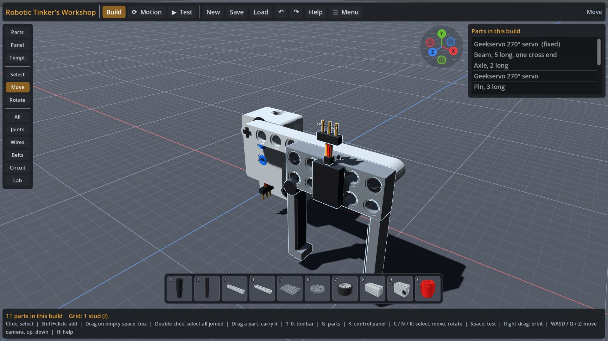
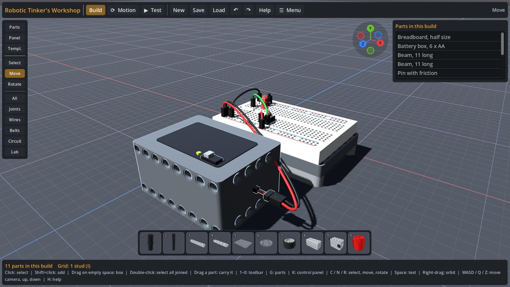
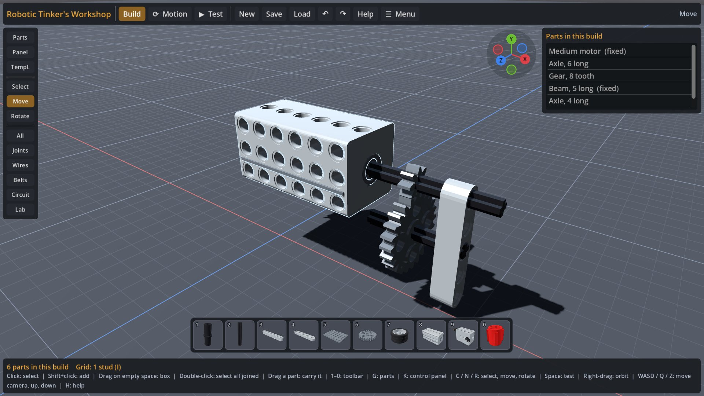
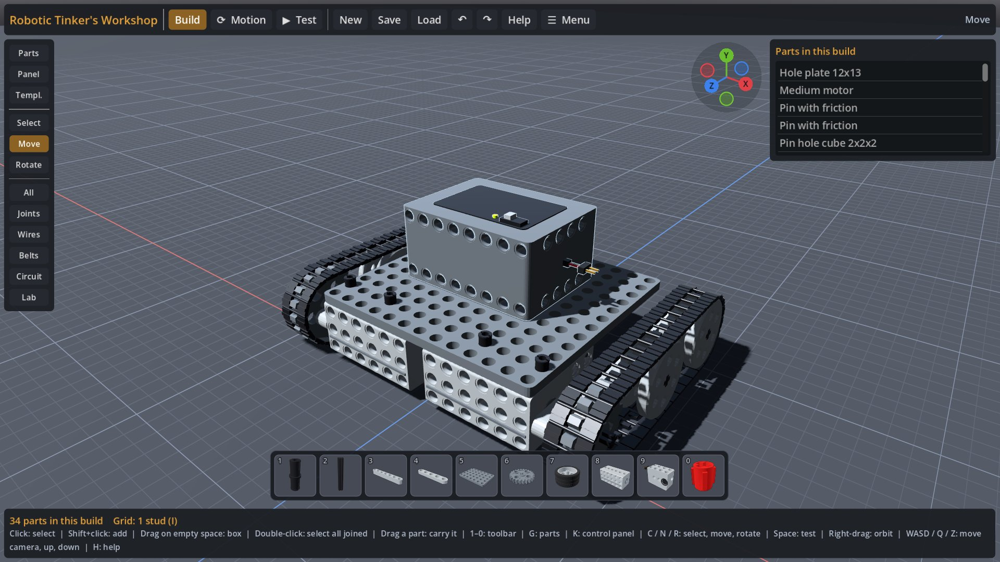

# Tinker's Bot Workshop: play the test build

**Build machines from pin-and-axle parts, then switch on the physics and watch them move.**

### ▶ [Play it in your browser](https://viper102012.github.io/rtw-play/)

Chrome or Edge on a PC works best. The first load takes a moment. This is a test build, so expect rough edges.

| | |
|---|---|
|  |  |
| Drive your build around the Backyard with WASD. | Run motors right on the bench and watch the gears and belts turn. |
|  |  |
| Servos, drivers and sliders for a robot arm. | Breadboards, LEDs, buttons and batteries, wired in 3D. |
|  |  |
| Gears that really mesh, with real ratios. | Chains and tracks, pulled by the sprockets. |

## What's in it

- **3D Workshop**: pins, axles, beams, plates, gears, wedge belt pulleys, tracks, motors, servos, springs, wheels and building blocks, all on an 8 mm grid. Press **Motion** to run it on the bench, or **Test** to drive it in a test map.
- **Spark Bench**: lessons, a circuit lab with volts, amps and watts, and board code you can run.

Try the examples under **Load**: the Four motor car, the Tracked vehicle, the Robot arm, the Belt drive and more.

## Found a bug or have an idea?

- [Report a bug](https://github.com/viper102012/rtw-play/issues/new?template=bug_report.yml): what you did, what you expected and what happened. A screenshot or your saved creation (the `.json` file from Save) helps a lot.
- [Suggest an idea or a new part](https://github.com/viper102012/rtw-play/issues/new?template=feature_request.yml)
- [Discussions](https://github.com/viper102012/rtw-play/discussions): questions, show off what you built, and chat.

Please read the [code of conduct](CODE_OF_CONDUCT.md) before posting.

## About this repository

This repository only holds the built game, and it's rebuilt automatically every time the game changes, so
pull requests here would be overwritten. The source is private.

© 2026 viper102012. All rights reserved. The game is free to play here for testing. Please don't copy, re-upload or redistribute it.
